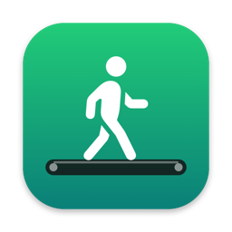
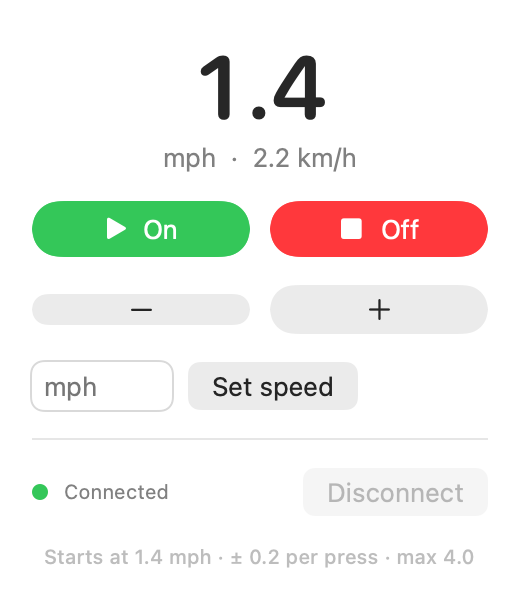

<p align="center">
  
</p>

<h1 align="center">Boardwalk</h1>

<p align="center">
  A small, free Mac app for controlling your under-desk walking treadmill over Bluetooth.
</p>

<p align="center">
  <a href="LICENSE"></a>
  
  <a href="https://github.com/Palmetto-Interactive-LLC/boardwalk/actions/workflows/build.yml"></a>
</p>

---

Lots of budget walking pads ship with a tiny remote that gets lost, or with no remote at all, and a phone app you don't want to open every time you change speed. Boardwalk puts the controls on your Mac instead.

<p align="center">
  <picture>
    <source media="(prefers-color-scheme: dark)" srcset="docs/screenshot-dark.png">
    
  </picture>
</p>

- **On and Off.** On ramps up to a comfortable 1.4 mph after the treadmill's start-up countdown.
- **Faster and slower** in 0.2 mph steps, plus **Set speed** for an exact number.
- **Live speed** in mph and km/h, read straight from the treadmill.
- **Stays connected.** It finds the treadmill on launch and reconnects on its own if the link drops.
- **Menu bar too.** A walking-figure icon in the menu bar shows your speed and opens the same controls.
- **Automation-friendly.** `boardwalk://` links let Shortcuts, Raycast, Alfred or a Stream Deck drive it.

It's a single Swift file with no dependencies, no account, no analytics, and no network access.

> [!WARNING]
> Boardwalk starts a motorized belt, sometimes from across the room. Please read [Safety and disclaimer](#safety-and-disclaimer) before you use it.

## Will it work with my treadmill?

Boardwalk talks to treadmills that support the standard **Bluetooth Fitness Machine Service (FTMS)**. Many walking pads that advertise compatibility with Zwift, Kinomap or the FitShow app use it.

| Status | Treadmill | Notes |
| --- | --- | --- |
| ✅ Tested | **YIJIAN ZBJ_38A_BT** controller. Shows up in Bluetooth as `ESLinker-xxxxxx`. | Found in many no-name ~$100 walking pads sold on Amazon. 0.5 to 4.0 mph. |
| 🟡 Should work | Walking pads marketed as Zwift or Kinomap compatible, for example Marcy Walk N Run, Black Lord walking pads, Christopeit Walking Pad 4.2, and KingSmith WalkingPad Z1 | Untested. These are based on vendor listings and community reports of FTMS support. Please [tell us](../../issues/new?template=compatibility-report.md) how it goes. |
| ❌ Won't work | KingSmith WalkingPad A1, P1, R1 and similar models | Community device lists show these use KingSmith's own protocol, not FTMS. |

**Check yours in two minutes.** Install the free **nRF Connect** or **LightBlue** app on your phone, turn the treadmill on, and scan. If the treadmill lists a **Fitness Machine** service (UUID `0x1826`), Boardwalk should be able to drive it.

Got it working on a model that isn't listed? Please open a [compatibility report](../../issues/new?template=compatibility-report.md) so the table can grow.

## Install

You need a Mac running **macOS 14 (Sonoma) or newer** with Bluetooth. You don't need Xcode. The free Command Line Tools are enough, and the setup script will offer to install them.

```bash
git clone https://github.com/Palmetto-Interactive-LLC/boardwalk.git
cd boardwalk
./setup.sh
```

That builds the app, installs it to `/Applications/Boardwalk.app`, and opens it. Then:

1. Read the safety notice and click **I Understand**.
2. Click **Allow** when macOS asks for Bluetooth access. You're only asked once.
3. Turn the treadmill on. If its phone app is open, close it, because the treadmill only talks to one device at a time.

The status dot at the bottom of the window turns green when it's connected. To keep Boardwalk handy, right-click its Dock icon and choose **Options › Keep in Dock**.

To update later, run `git pull` and then `./setup.sh` again.

<details>
<summary>Why does setup add a certificate to my keychain?</summary>

macOS remembers Bluetooth permission per app identity. An app you build yourself would normally get a new identity on every build, so macOS would ask for Bluetooth again after each update. To avoid that, `scripts/signing-identity.sh` creates a self-signed certificate called **Boardwalk Local Signing** in your login keychain and signs the app with it. It never leaves your Mac and is only used for code signing.

If you'd rather use your own Apple Development certificate, run `SIGN_IDENTITY="Apple Development: you@example.com (TEAMID)" ./setup.sh`.

</details>

## Using it

| Control | What it does |
| --- | --- |
| **On** | Starts the belt. The treadmill counts down for about two seconds at 0.5 mph, then Boardwalk takes it to 1.4 mph. |
| **Off** | Stops the belt. |
| **− / +** | Slower or faster by 0.2 mph. Presses during the start-up countdown are held and applied when it ends. |
| **Set speed** | Type a speed in mph and press Return. If the belt is stopped, the next **On** uses that speed instead of 1.4. |
| **Connect / Disconnect** | Boardwalk connects on its own. Disconnect frees the treadmill for its phone app. It's disabled while the belt is moving so you can't lose control mid-walk. |

### Shortcuts and automation

Boardwalk responds to these links:

| Link | Action |
| --- | --- |
| `boardwalk://on` | Start |
| `boardwalk://off` | Stop |
| `boardwalk://faster` | +0.2 mph |
| `boardwalk://slower` | −0.2 mph |
| `boardwalk://speed?mph=2.5` | Set an exact speed |

In the **Shortcuts** app, make a shortcut with a single **Open URLs** action and one of the links above. Then pin it to the menu bar, add it to the Dock, or give it a keyboard shortcut. You can try any of them from Terminal too:

```bash
open -g "boardwalk://faster"
```

### Changing the defaults

The start speed and step size are constants at the top of [`Sources/Boardwalk.swift`](Sources/Boardwalk.swift):

```swift
let STEP_MPH = 0.2
let START_MPH = 1.4
```

Edit them and run `./setup.sh` again.

## Troubleshooting

**Status says "Looking for treadmill…" and stays there.** Make sure the treadmill is plugged in and switched on, and that its phone app isn't connected to it. Force-quitting the phone app usually frees it. Then click **Connect**.

**"Bluetooth permission denied".** Open **System Settings › Privacy & Security › Bluetooth** and turn Boardwalk on.

**On works but the speed doesn't change.** The treadmill ignores speed changes during its start-up countdown. Boardwalk accounts for that on the tested model. If your treadmill behaves differently, please open a [compatibility report](../../issues/new?template=compatibility-report.md) and attach your log.

**Where's the log?** `~/Library/Logs/Boardwalk.log`. It records connections, commands and the belt speed the treadmill reports, and nothing else.

## Uninstall

```bash
pkill -x Boardwalk
rm -rf /Applications/Boardwalk.app ~/Library/Logs/Boardwalk.log
defaults delete com.palmettointeractive.boardwalk
security delete-certificate -c "Boardwalk Local Signing"
```

## How it works

Boardwalk uses Apple's CoreBluetooth framework to talk FTMS directly to the treadmill. There's no background service and no helper process. [docs/PROTOCOL.md](docs/PROTOCOL.md) documents the exact commands and the firmware quirks we measured, which should also help anyone writing their own controller.

```
Sources/Boardwalk.swift      the whole app: Bluetooth, UI, URL handling
Resources/Info.plist         bundle settings, Bluetooth usage text, boardwalk:// scheme
scripts/build.sh             builds build/Boardwalk.app
scripts/make_icon.swift      draws the app icon
scripts/signing-identity.sh  creates the local signing certificate
setup.sh                     build + install + launch
docs/PROTOCOL.md             FTMS commands and firmware notes
```

## Safety and disclaimer

Boardwalk controls a motorized belt that can injure people. By using it, you accept the following.

- **It can start the belt remotely.** That includes shortcuts and automations. Make sure nobody, especially kids and pets, is on or near the treadmill when it might start.
- **It doesn't replace your treadmill's safety features.** Keep the treadmill's own stop button, safety key or clip, and power switch working and within reach. Know how to stop it without this app.
- **Wireless links fail.** If Bluetooth drops, or your Mac sleeps or crashes, the belt may keep running at its last speed until you stop it some other way.
- **It's unofficial.** Boardwalk isn't made, endorsed or supported by any treadmill manufacturer. Using third-party software with your treadmill may affect its warranty. Product names are trademarks of their owners and appear here only to describe compatibility.
- **It isn't a medical or fitness device.** Speeds, distances and anything else it shows aren't guaranteed to be accurate. Talk to a doctor before starting an exercise program.

**Boardwalk is provided "as is", without warranty of any kind. You use it entirely at your own risk. Palmetto Interactive LLC and Boardwalk's contributors are not liable for any injury, death, damage to your treadmill or other property, or any other loss arising from its use.** The [MIT License](LICENSE) is the governing legal text, and it includes the full warranty disclaimer and limitation of liability.

## Contributing

Compatibility reports are the most useful thing you can send. Bug reports and small, focused pull requests are welcome too. See [CONTRIBUTING.md](CONTRIBUTING.md), and please report security issues privately as described in [SECURITY.md](SECURITY.md).

## License

[MIT](LICENSE) © 2026 Palmetto Interactive LLC.

<p align="center"><sub>Built by <a href="https://palmettointeractive.com">Palmetto Interactive</a>.</sub></p>
